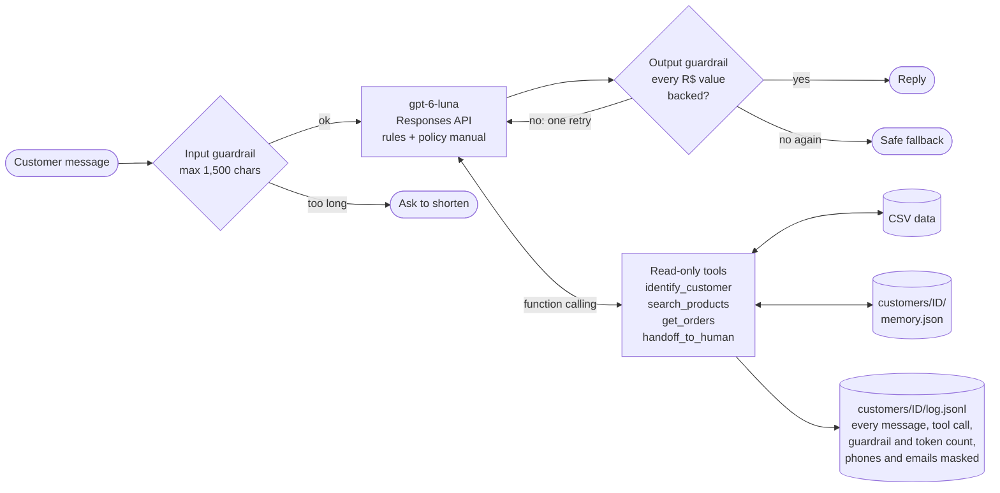

# Empório da Música customer service agent

A text-message assistant for Empório da Música, a fictional musical instrument store in Campo Grande/MS. It answers
in Brazilian Portuguese as "Duda", looks up products, prices and orders through tools, applies the store's policy
manual, and declines what is out of scope.

The core is small: one OpenAI model, four read-only tools and a tool loop of about 50 lines. Business rules that a language
model tends to get wrong (price math, date windows, who may see which order) live in plain Python and are tested.

## Run it

Tested on Python 3.12, Linux.

```bash
python3 -m venv .venv && source .venv/bin/activate
pip install -r requirements.txt
cp .env.example .env              # then set OPENAI_API_KEY
python -m emporio --today 2026-03-25
```

Type messages after `Você:`; `sair` ends the conversation and saves the customer's memory.

**Why `--today`:** the orders in the data go from October 2025 to March 2026. With the real date, every pending order
looks months late and every return window has closed. `--today 2026-03-25` puts the clock inside the data. Without it,
the agent uses today's date. Opening hours always use the real clock (America/Campo_Grande).

Other commands:

| Command | What it does |
|---|---|
| `python -m pytest` | 55 offline tests, no network (the live ones are skipped) |
| `RUN_LIVE=1 python -m pytest tests/test_live.py -v` | 14 scenarios against the real model, about 1 minute |
| `python -m scripts.eval_live --runs 5` | runs the live scenarios 5 times, writes `tests/EVAL_RESULTS.md` |
| `python -m scripts.ops_report` | report for the store team built from the conversation logs |
| `python -m scripts.audit_data` | data quality audit, writes `data/DATA_REPORT.md` |
| `python -m scripts.extract_policies` | extracts the policy PDF to `data/policies.txt` (already done) |

## What it looks like

Six conversations recorded with the CLI against the real model are in [`examples/`](examples):

- [Product search with a budget](examples/01_catalog_search.md)
- [Price lookup and store information](examples/02_price_and_store_info.md)
- [Return request](examples/03_return_request.md): identifies the customer, reads the order, applies the 7-day rule
  and points to the 90-day legal warranty that still applies
- [Guardrails](examples/04_guardrails.md): accessories, prompt injection, someone else's order, haggling
- Long-term memory: [first visit](examples/05_memory_first_visit.md) and
  [second visit](examples/05_memory_second_visit.md), where the agent recalls the request and checks the catalog again

The same folder has what those conversations left behind: an [audit log](examples/audit_log_customer_14.jsonl), a
[memory file](examples/memory_customer_3.json) and the [team report](examples/team_report.md).

## How it works



| File | Role |
|---|---|
| `emporio/store.py` | loads the CSVs; the tools and their business rules |
| `emporio/agent.py` | prompt, tool loop, guardrails, memory summary |
| `emporio/customer_records.py` | masked per-customer log and memory files |
| `emporio/__main__.py` | terminal chat |
| `scripts/` | PDF extraction, data audit, live evaluation, team report |

## Technical decisions

**No agent framework.** Four tools and the loop that runs them fit in about 50 lines with the OpenAI SDK. A framework would add a layer
to learn and debug without solving anything this problem has. The loop is easy to read and to audit.

**Model: `gpt-6-luna`.** It is OpenAI's cheapest tier with function calling and structured outputs (US$ 0.10 / 0.50 per
million input / output tokens). The live evaluation showed it was good enough, so there was no reason to pay for a
bigger model. Reasoning effort is `low` to keep replies fast. I used the Responses API because, for this model, Chat
Completions only supports function calling with reasoning turned off. Requests use `store=False`, so no conversation is
kept on OpenAI's side; the reasoning items are replayed on each call.

**Policies: whole manual in the prompt, no RAG.** The manual is 13 KB of text, about 4k tokens. Chunking and retrieval
would add a failure mode (the right paragraph not retrieved) and gain nothing at this size. The prompt is built so the
rules and the manual form a fixed prefix; the clock goes last, so about 95% of each call's input is served from
OpenAI's prompt cache. I would switch to retrieval if the manual grew to dozens of pages.

**Data: tools, not a SQL agent.** The model never writes queries. It calls typed functions with a strict schema
(category is an enum of the real categories). The functions return prices already calculated: list price, active
promotion, PIX price (5%, not combined with promotions, manual 6.2) and the longest interest-free card plan allowed
(manual 3.1). For orders they return the days since purchase and delivery and whether each policy window is still open.
The model only phrases the answer. Arithmetic and dates are where I trust an LLM least, and in code they are easy to
test.

**Prompt strategy.** Short rule groups (voice, data, orders and identity, scope and security), followed by the manual
between `<manual>` tags. The rules came out of real runs: each time a test or a read-through as a customer showed a
bad answer, the fix became a rule. Examples: "speak as the store, not about the system", "ask before handing over to
the team", "memory can be outdated, search again".

**Guardrails**, in the order a message meets them:

| Layer | Guardrail |
|---|---|
| Input | messages over 1,500 characters are refused without calling the model |
| Prompt | scope (instruments only), persona, customer messages and tool results treated as data, not instructions |
| Tools | read-only; the customer id lives in the session and is never a model argument, so the model cannot ask for another customer's orders; a missing order and someone else's order get the same answer; 3 identification attempts per conversation; one identity per conversation |
| Output | every `R$` amount in a reply must match a price field returned by a tool, a value in the manual or an amount the customer typed; otherwise the model gets one retry, then a safe fallback message |

**Per-customer log and long-term memory.** Every message, tool call (arguments and result), guardrail decision and
token count is appended to `customers/<id>/log.jsonl`. Events before identification go to an anonymous file and are
moved into the customer's log once they are identified. Phones and emails are masked before anything is written
(manual section 9, LGPD). At the end of a conversation the model summarizes up to 8 facts about the customer with a
structured output (interests, budget, open issues; never prices, stock or contact data). The facts are returned the
next time the customer is identified. I chose plain files over a database because this is a single-process demo and
the files are easy to inspect. The log is what makes the team report and the cost numbers possible.

**Interface: CLI.** The brief puts the focus on the agent. Piped input is echoed, so a script of messages produces a
readable transcript, which is how the examples were recorded.

## Data treatment

The raw files in `data/raw/` are never edited. `scripts/audit_data.py` checks them and writes
[`data/DATA_REPORT.md`](data/DATA_REPORT.md) with each finding and the decision taken. The main ones:

- An email shared by two customers, so the phone (unique in the data) is the identification key.
- A discontinued bass with 13 units in stock, and a `coming_soon` ukulele that already shows up in orders. Only
  `active` products with stock are offered.
- Two order totals that do not match their items, and PIX orders without the 5% discount. Order items have no unit
  price, so the agent reports totals as recorded and never recalculates a bill.
- Three historical orders with installments below the manual's minimum.
- The manual gives two phone numbers, an email with an accent in the domain, and a payment table that contradicts
  section 3.1.
- No promotion called Black Friday is active, although the manual says it runs in November. The agent never offers it.

## Assumptions

- The estimated delivery date stands in for the receipt date, since there is no actual delivery date. The 7-day
  withdrawal (4.1) and the 90-day legal warranty (8.1) count from it; the 30-day defect exchange (4.2) counts from the
  purchase, as the manual says.
- Installments follow section 3.1: up to 3x with a R$ 50 floor (my reading of "sem valor mínimo, exceto abaixo de
  R$ 50"), R$ 80 from 4x, R$ 100 from 7x.
- Official contact: (67) 3341-4444 and contato@emporiodamusica.com.br, which appear on the cover and in the company
  data table. The agent gives only these.
- Holidays are not in the data, so a holiday shows as a regular working day.
- Freight outside the Campo Grande area depends on ZIP code, weight and dimensions, which the data does not have, so
  it is not calculated. The manual's fixed rules (free above R$ 500, R$ 35 below, in the metro area) are in the prompt.

## Testing and evaluation

- **Offline (55 tests, under a second):** the store rules, masking, the log and memory files, the team report and the
  agent loop with a fake OpenAI client built from real SDK types.
- **Live (14 scenarios):** behavior checks against the real model: which tool ran, which guardrail fired, what must
  never appear in a reply. Nine come from the brief and common requests; five come from the data traps (haggling, an
  expired Black Friday, a discontinued product, an empty category, switching identity mid-conversation).
- **Evaluation:** model output varies between runs, so one green run proves little. `scripts/eval_live.py` repeats the
  scenarios and reports the pass rate of each. The latest run is in [`tests/EVAL_RESULTS.md`](tests/EVAL_RESULTS.md):
  70/70. Earlier runs that day had three false negatives in my own test (fixed) and two failures I could not diagnose
  because the reply was not recorded yet. Since then each failure records the agent's reply.
- **Cost:** the six example conversations used 30 model calls and cost US$ 0.0037 in total, about US$ 0.0006 each.

### What testing caught

Each of these was a commit of its own:

| Found by | Problem | Fix |
|---|---|---|
| code review | replayed SDK items carried null fields (`async_`) the API rejects, which would break every tool turn | `model_dump(exclude_none=True)` and a test with real SDK types |
| code review | the 30-day defect exchange counted from delivery, the manual says from purchase | count from the order date |
| offline test | the price guardrail accepted any difference of two known numbers (R$ 1,500 = 2,000 - 500) | only exact values |
| live test | the customer's own budget ("até R$ 1.000") was blocked as an unverified price | accept amounts the customer typed |
| live test | memory was never saved: the agent only identified customers who asked about an order | identify as soon as a phone or email is given |
| reading as a customer | a ukulele was called "violão"; ten products in one message; "o sistema indica..." | name items as returned; at most 4 options; speak as the store |
| reading as a customer | handed over to the team without asking, twice for the same case | ask first, one handoff per issue |
| recorded example | the model searched four product names at once and the all-terms search found nothing; the memory then stored "not in the catalog" | rank by matched terms; memory keeps facts about the customer only |

## Known limitations and what I would do with more time

- **Identity is a phone number.** Anyone who knows a customer's phone can read their orders. In production: a one-time
  code sent by WhatsApp before showing order data.
- **The price guardrail is a pattern match on `R$` amounts.** It does not catch a wrong number written without `R$`, or
  a wrong fact that is not a price. Next step: a second check of each reply against the tool results, or an
  LLM-as-judge in the evaluation.
- **Search is keyword-based.** It ranks by matched words, which is enough for 65 products but has no synonyms ("violão
  para criança"). With a bigger catalog: Postgres full-text search or embeddings.
- **Log files are not safe for concurrent writes** and have no retention policy or deletion command, which LGPD
  requires. In production: a database table with a retention job and a "forget me" action.
- **The evaluation is small:** 14 scenarios written by me. With more time: scenarios sampled from real conversations,
  and a judge model to score tone, which my regex checks cannot measure.
- **One channel.** WhatsApp integration would reuse the same `Agent.reply`.

## How I used AI coding assistants

I built this with **Claude Code** (Anthropic's terminal agent, model Claude Opus 5.5). **Claude wrote most of the
code, the tests and the first draft of this README.** My work was deciding what to build, setting the rules Claude
works under, judging the results and choosing which fixes to make. This section describes that setup.

### What I decided

The features (tool calling, guardrails, a per-customer audit log, long-term memory, the evaluation and the team
report), the scope ("as simple as possible", so no framework, no RAG, no UI), and the bar for done. I read every
recorded answer as if I were the customer and asked for the tone changes ("simpático e informativo"); several fixes in
the table above came from that reading, not from tests.

### How I keep code quality

- **Rules in a global instruction file** that Claude loads in every session. The main ones: never say something works
  without running it (tests, build or a real call); take the smallest change that fully solves the problem, in this
  order: don't build it, use the standard library, one line, then an abstraction; no new dependency when the standard
  library does it; never cut validation, error handling or security to make code shorter; comments explain why, not
  what; check every external library against current documentation before using it.
- **A minimal-code plugin** that is always on. It pushes back on speculative abstractions and options nobody asked for,
  and any deliberate shortcut must carry a `shortcut:` comment naming its limit, so it can be listed later as debt.
- **A pre-mortem before building.** For any plan of this size, Claude first argues how it would fail. Here it surfaced
  the data traps, which is why the data audit came before the agent.
- **Skepticism about good numbers.** When the first evaluation came back at 100%, the rule is to distrust it. That is
  why I added five harder scenarios from the data traps; the next run found real failures.
- **Review with separate lenses.** A review command runs parallel subagents: one for code (runs the tests, scans for
  secrets, checks every API call against current docs, looks for failure paths and dead code), one for prose and one
  for a pre-mortem of the delivery. Each finding needs a concrete failing case before it is reported. The first review
  found the two bugs at the top of the table above.
- **A writing pass** that removes AI-sounding text from docs and comments.
- **Real runs over mocks.** The offline tests use a fake client built from the SDK's real types, and the live tests and
  evaluation call the real model, because the bugs that mattered only showed up there.

### How I keep version control clean

- **One logical change per commit**, in Conventional Commits (`feat:`, `fix:`, `test:`, `refactor:`, `docs:`), in
  English. Every fix in this repo has its own commit, in the order the problem was found.
- **A commit command** that runs the tests, scans the diff for secrets and only then commits. Secrets live in `.env`,
  which is ignored; `.env.example` documents the variables.
- **No AI co-author lines in the history.** This section is where I disclose how the commits were made.
- **Guards against irreversible actions.** A shell hook blocks force pushes, hard resets, branch deletions, recursive
  deletes outside the project and similar commands, and global git hooks control where each repository may be pushed.
- **Traceability.** Every prompt and tool call of a session is logged locally, a memory plugin keeps decisions and the
  project state between sessions, and an end-of-work command checks that the project notes are updated and everything
  is committed. My Claude configuration is itself versioned in git.
