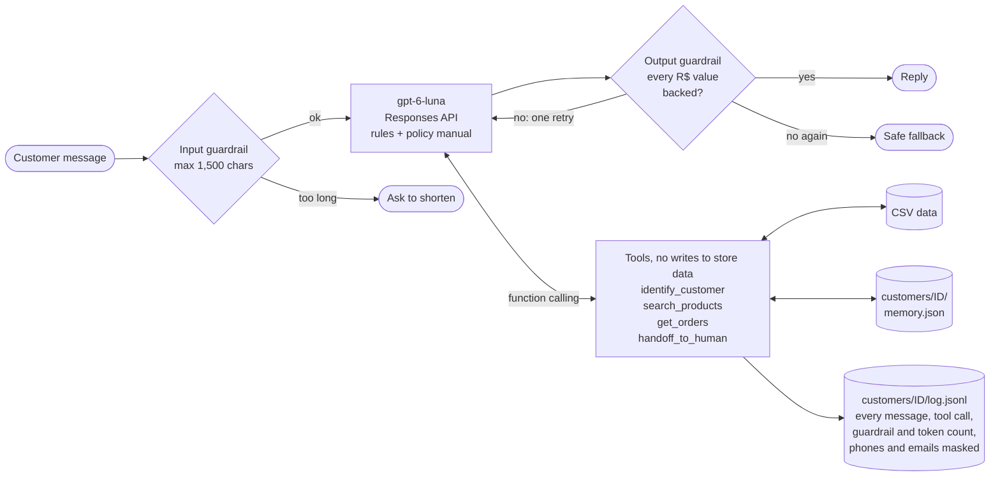

# Empório da Música customer service agent

[](https://github.com/Appa019/emporio-da-musica-agent/actions/workflows/tests.yml)

A text-message assistant for Empório da Música, a fictional musical instrument store in Campo Grande/MS. It answers
in Brazilian Portuguese as "Duda", looks up products, prices and orders through tools, applies the store's policy
manual, and declines what is out of scope.

The core is small: one OpenAI model, four tools and a tool loop of about 50 lines. Business rules that a language model
tends to get wrong (price math, date windows, who may see which order) live in plain Python and are tested. In
numbers: 55 offline tests on Linux, Windows and macOS; 14 live scenarios run 5 times, 70/70 in the
[latest evaluation](tests/EVAL_RESULTS.md); about US$ 0.0006 per conversation.

**Core and extras.** What the brief asks for is `emporio/store.py` plus the prompt and tool loop in
`emporio/agent.py`. The rest is extra, and each piece has one reason: guardrails, because an agent that quotes prices
and shows orders must not invent either; a per-customer log, so every answer can be traced to the tool results behind
it; memory, so a returning customer does not repeat themselves; a data audit, because the CSVs and the manual
disagree in places; and a repeated evaluation, because one green run of a non-deterministic model proves little.

## Run it

Python 3.12. Linux and macOS:

```bash
python3 -m venv .venv && source .venv/bin/activate
pip install -r requirements.txt
cp .env.example .env              # then set OPENAI_API_KEY
python -m emporio --today 2026-03-25
```

Windows (PowerShell):

```powershell
py -3.12 -m venv .venv; .venv\Scripts\Activate.ps1
pip install -r requirements.txt
copy .env.example .env            # then set OPENAI_API_KEY
python -m emporio --today 2026-03-25
```

Type after `Você:`; `sair` ends the conversation and saves the customer's memory. `OPENAI_MODEL` in `.env` changes the
model (default `gpt-6-luna`).

**Why `--today`:** the orders go from October 2025 to March 2026. With the real date, every pending order looks months
late and every return window has closed, so `--today` puts the clock inside the data. Opening hours always use the
real clock (America/Campo_Grande).

| Command | What it does |
|---|---|
| `python -m pytest` | 55 offline tests, no network |
| `RUN_LIVE=1 python -m pytest tests/test_live.py -v` | 14 scenarios against the real model, about 1 minute (PowerShell: `$env:RUN_LIVE=1` first) |
| `python -m scripts.eval_live --runs 5` | repeats the live scenarios, writes `tests/EVAL_RESULTS.md` |
| `python -m scripts.audit_data` | data quality audit, writes `data/DATA_REPORT.md` |
| `python -m scripts.ops_report` | report for the store team from the conversation logs |
| `python -m scripts.extract_policies` | policy PDF to `data/policies.txt` (already done) |

## Example conversations

Recorded with the CLI against the real model, in [`examples/`](examples):

- [Product search with a budget](examples/01_catalog_search.md)
- [Price lookup and store information](examples/02_price_and_store_info.md)
- [Return request](examples/03_return_request.md): identifies the customer, reads the order, applies the 7-day rule
  and points to the 90-day legal warranty
- [Guardrails](examples/04_guardrails.md): accessories, prompt injection, someone else's order, haggling
- Memory: [first visit](examples/05_memory_first_visit.md) and [second visit](examples/05_memory_second_visit.md)

The same folder has the [audit log](examples/audit_log_customer_14.jsonl), a
[memory file](examples/memory_customer_3.json) and the [team report](examples/team_report.md) they produced.

## How it works



`emporio/store.py` holds the tools and business rules, `emporio/agent.py` the prompt, loop and guardrails,
`emporio/customer_records.py` the masked log and memory files, `emporio/__main__.py` the terminal chat.

## Technical decisions

**Function calling, no framework.** Four tools and their loop fit in about 50 lines with the OpenAI SDK. A framework
would add a layer to learn and debug without solving anything this problem has.

**Model: `gpt-6-luna`.** OpenAI's cheapest tier with function calling and structured outputs (US$ 0.10 / 0.50 per
million input / output tokens), and the evaluation showed it was good enough. Reasoning effort is `low` for speed. I
used the Responses API because for this model Chat Completions only does function calling with reasoning off. With
`store=False` OpenAI does not keep responses for later retrieval (abuse-monitoring logs, up to 30 days, still apply).

**Policies in the prompt, no RAG.** The manual is about 4k tokens. Retrieval would add a failure mode (the right
paragraph not found) and gain nothing at this size. Rules and manual form a fixed prefix with the clock last, so about
95% of each call's input comes from the prompt cache. I would switch to retrieval if the manual grew to dozens of pages.

**Data through tools, not a SQL agent.** The model calls typed functions with a strict schema and never writes
queries. The tools return prices already calculated (promotion, PIX 5% not combined with promotions, longest
interest-free plan allowed) and, for orders, whether each policy window is still open. Arithmetic and dates are where
I trust an LLM least, and in code they are easy to test.

**Prompt.** Short rule groups (voice, data, orders and identity, scope and security), then the manual in `<manual>`
tags. Most rules came from real runs: when a test or a read-through as a customer showed a bad answer, the fix became
a rule, such as "speak as the store, not about the system" or "ask before handing over to the team".

**Guardrails**, in the order a message meets them:

| Layer | Guardrail |
|---|---|
| Input | messages over 1,500 characters are refused before calling the model |
| Prompt | scope (instruments only); customer messages and tool results are data, not instructions |
| Tools | no tool changes store data; the customer id lives in the session, never in a model argument, so the model cannot ask for another customer's orders; 3 identification attempts and one identity per conversation |
| Output | every `R$` amount must match a tool price, the manual or the customer's own message; otherwise one retry, then a safe fallback |

**Log and memory.** Every message, tool call, guardrail decision and token count goes to
`customers/<id>/log.jsonl`, with phones and emails masked (manual section 9, LGPD). At the end of a conversation the
model saves up to 8 facts about the customer (interests, budget, open issues; never prices or stock), returned on their
next visit. Plain files, because this is a single-process demo and files are easy to inspect.

**Interface: CLI.** The brief puts the focus on the agent. Piped input is echoed, which is how the examples were
recorded.

## Data and assumptions

The raw files are never edited. `scripts/audit_data.py` writes [`data/DATA_REPORT.md`](data/DATA_REPORT.md) with each
finding and the decision taken:

- One email is shared by two customers, so the phone is the identification key.
- A discontinued bass has stock and a `coming_soon` ukulele appears in orders; only `active` products in stock are
  offered.
- Some order totals are below the current list price and some PIX orders lack the 5% discount. Items have no unit
  price, so the agent reports totals as recorded and never recalculates a bill.
- The data marks every Black Friday promotion as inactive, though the manual says it runs in November; the agent
  follows the data.
- The estimated delivery date stands in for the receipt date. The 7-day withdrawal and 90-day warranty count from it;
  the 30-day defect exchange counts from the purchase, as the manual says.
- Installments follow manual 3.1: up to 3x with a R$ 50 floor, R$ 80 from 4x, R$ 100 from 7x.
- Holidays are not in the data, and freight outside Campo Grande needs ZIP code and weight, so neither is handled.

## Testing

- **Offline:** 55 tests for the store rules, masking, log and memory files, and the agent loop with a fake client
  built from real SDK types.
- **Live:** 14 scenarios that check behavior, not wording: which tool ran, which guardrail fired, what must never
  appear. Five come from the data traps (haggling, inactive Black Friday, a discontinued product, an empty category,
  switching identity mid-conversation).
- **Evaluation:** `scripts/eval_live.py` repeats the scenarios and reports each pass rate. Latest run: 70/70. Earlier
  runs that day had two failures I could not diagnose because the reply was not recorded yet; failures record it now.

What testing caught, each fixed in its own commit:

| Found by | Problem | Fix |
|---|---|---|
| code review | replayed SDK items carried null fields the API rejects, breaking every tool turn | `model_dump(exclude_none=True)` |
| code review | the 30-day defect exchange counted from delivery, the manual says from purchase | count from the order date |
| live test | the customer's own budget ("até R$ 1.000") was blocked as an unverified price | accept amounts the customer typed |
| live test | memory was never saved: customers were only identified when asking about an order | identify as soon as a phone or email is given |
| reading as a customer | a ukulele called "violão", ten products in one message, a handoff without asking | name items as returned, at most 4 options, ask first |
| recorded example | a search with four product names found nothing and memory stored "not in the catalog" | rank by matched terms; memory keeps customer facts only |

## Limitations and what I would do with more time

- **Identity is a typed phone number.** In the CLI, anyone who knows a customer's phone can read their orders. On
  WhatsApp the sender's number is already verified; a one-time code is only needed for a different phone or an email.
- **The price guardrail only checks `R$` amounts,** not other facts. Next: check each reply against the tool results,
  or an LLM judge in the evaluation.
- **Keyword search,** enough for 65 products but without synonyms. With a bigger catalog: full-text search or
  embeddings.
- **Log files** are not safe for concurrent writes, have no retention or deletion (LGPD), and customers are not told
  facts are kept. In production: a database table, a retention job, a "forget me" action and a notice.
- **A small evaluation** written by me, with regex checks that cannot score tone. Next: scenarios sampled from real
  conversations and a judge model.

## How I used AI coding assistants

I built this with **Claude Code** (Anthropic's terminal agent, model Claude Opus 5.5). **Claude wrote most of the
code, the tests and the first draft of this README.** I decided what to build and the scope, set the rules Claude works
under, read every recorded answer as a customer and chose the fixes. Several rows of the table above came from that
reading, not from tests.

How I keep the quality up:

- A global instruction file loaded in every session: never claim something works without running it; take the
  smallest change that solves the problem; no dependency the standard library covers; never trade validation or
  security for brevity; check libraries against current docs.
- A pre-mortem before building, which surfaced the data traps, so the data audit came before the agent.
- Distrust of good numbers: the first evaluation came back at 100%, so I added five harder scenarios, and the next run
  found real failures.
- A review command that runs separate lenses (code, prose, pre-mortem) in parallel subagents and reports only findings
  with a concrete failing case. It found the two bugs at the top of the table above.
- One logical change per commit in Conventional Commits, tests and a secret scan before each commit, and CI on Linux,
  Windows and macOS.
